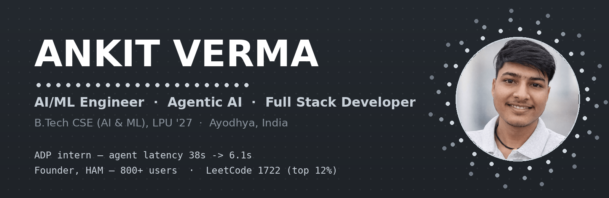

# Hi, I'm Ankit Verma

I build AI systems that run in production — LLM agents, RAG pipelines and the full-stack products around them. Final-year B.Tech CSE (AI & ML) student at Lovely Professional University, graduating in 2027.

Currently building **Zenthraxo**, an AI WhatsApp automation platform (public beta), and open to AI/ML, GenAI and software engineering internships.

[LinkedIn](https://www.linkedin.com/in/ankitverma969) · [LeetCode](https://leetcode.com/ankitverma969) · [Email](mailto:hpvankitverma@gmail.com) · [Instagram](https://www.instagram.com/radhaji969)

---

## About

- AI/ML Intern at **ADP** (Jul – Sep 2026), where I worked on agentic AI for enterprise HCM software
- Founder of **HAM**, an education platform used by 800+ students (Feb 2024 – Feb 2026)
- I mostly work on agent orchestration, retrieval, and evaluation — making LLM systems faster and more reliable, not just demo-able
- Based in Ayodhya, Uttar Pradesh, India

## What I work with

**Languages:** Python, C++, Java, JavaScript, TypeScript, Go

**AI / GenAI:** LangChain, LangGraph, RAG, PyTorch, TensorFlow, scikit-learn, NLP, prompt engineering

**Web & backend:** React, Node.js, Express, FastAPI, MongoDB, MySQL, REST APIs, Socket.IO, Tailwind CSS

**Tools:** Git, GitHub, Docker, AWS, Linux, Jenkins (CI/CD), Postman

---

## Experience

### ADP — AI/ML Intern, HCM & Agentic AI
*Jul 2026 – Sep 2026*

- Built a compensation agent for HCM/Core HR covering 6 compensation operations across 7 APIs
- Designed deterministic agentic workflows using LLMs, RAG and tool calling
- Brought API latency down from 38s to 6.1s through parallel execution and caching
- Reduced token usage by 62–95% with prompt caching and token optimisation
- Evaluated the system with 210 tool-calling tests and 102 unit tests — about 99.9% tool-calling success, and roughly 92% grounded responses across 150 retrieval queries

### HAM — Founder, Full Stack Developer, Research Assistant
*Feb 2024 – Feb 2026*

- Built and ran an education platform for academic project guidance, used by 800+ users
- Real-time messaging system handling 10,000+ messages between students and mentors
- Added three AI/NLP modules: project recommendation, language detection and document summarisation
- Shipped 12+ authenticated backend APIs with payments and Excel reporting
- NLP chatbot for intent classification, 95% accuracy on 1,000+ messages

---

## Selected projects

| Project | What it is |
|---|---|
| **Zenthraxo — WhatsApp Reply Engine** | AI auto-reply platform with a knowledge base, developer APIs and multi-user workspaces. A 3-stage LangChain/LangGraph pipeline handles intent and language detection (95% accuracy) across many chats at once, each on its own thread. *(private repo)* |
| **[AgentReplay](https://github.com/ankitverma969/AgentReplay)** | Local debugging tool for AI agent runs — records traces so you can replay, diff and profile executions. |
| **[AI-Powered Career Guidance System](https://github.com/ankitverma969/AI-Powered-Career-Guidance-System)** | Predicts student performance and recommends careers, with SHAP explanations for each prediction. |
| **[NLP Language & Sentiment Service](https://github.com/ankitverma969/NLP-Language-Sentiment-Service)** | FastAPI microservice for language detection and sentiment analysis, including Hinglish text. |
| **[Ticket System](https://github.com/ankitverma969/Ticket-System)** | Support ticket API in Go (Chi, MongoDB, JWT) with Swagger docs. |
| **[Vireo — Audio Refund Intelligence](https://github.com/ankitverma969/vireo-audio-refund-intelligence)** | Refund audit tool for support tickets, with rule-based NLP triage and a finance dashboard. |
| **[Multi-Window Media Sequencer](https://github.com/ankitverma969/multi-window-media-sequencer)** | Digital signage system running independent looping playlists across four screens, with synchronised overrides. |
| **[ResumeAnalyser](https://github.com/ankitverma969/ResumeAnalyser)** | ATS resume analyser with scoring, Gemini insights and job-description matching. |
| **Internship Hub** | Multi-role internship platform (admin, supervisor, student) with live communication — cut manual work by 40%. *(private repo)* |

More in the pinned repositories below.

---

## GitHub activity

  
  

---

## Achievements & certifications

- **INSPIRE-SHE Scholar** — DST, Government of India. Rs. 1,20,000 scholarship plus a Rs. 20,000 mentorship grant; among the top 1% of students nationally
- **LeetCode** contest rating **1722** — top 12% globally ([profile](https://leetcode.com/ankitverma969))
- **3rd place** — Entrepreneurial Boot Camp, LPU E-Cell
- **Oracle Cloud Infrastructure Certified AI Foundations Associate** — Oracle University, Oct 2026
- **Oracle AI Database Certified Foundations Associate** — Oracle University, Oct 2026
- **From Data to Decisions: A Hands-On Approach to Data Science** — LPU, Jul 2025

## Education

**Lovely Professional University**, Punjab — B.Tech, Computer Science & Engineering (AI & ML specialisation), 2023 – 2027 · CGPA 8.26

---

The fastest way to reach me is [LinkedIn](https://www.linkedin.com/in/ankitverma969) or [email](mailto:hpvankitverma@gmail.com).
