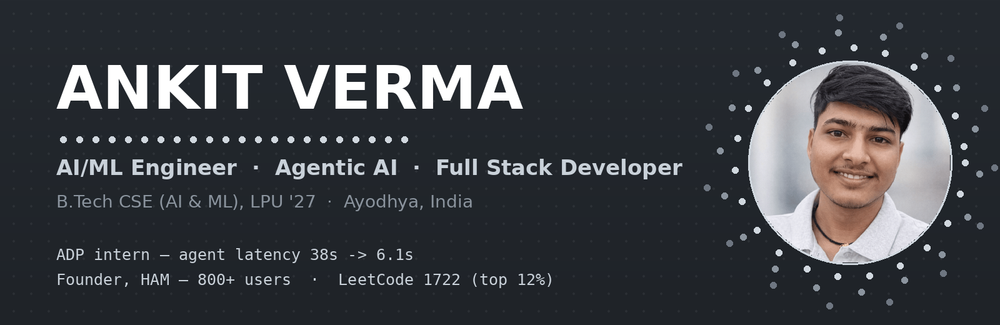

# Ankit Verma

**AI/ML Engineer — Agentic AI, LLM Systems and Full-Stack Development**

Final-year B.Tech CSE (AI & ML) student at Lovely Professional University, graduating June 2027.
I build AI systems that run in production: LLM agents, RAG pipelines and the full-stack products around them.

 

 

Ayodhya, Uttar Pradesh, India &nbsp;·&nbsp; Open to AI/ML, GenAI and Software Engineering internships

---

## About

- **AI/ML Intern at ADP** (Jul – Sep 2026) — built a production compensation agent for enterprise HCM software using agentic AI, RAG and tool calling
- **Founder of HAM** — an education platform used by 800+ students (Feb 2024 – Feb 2026)
- Currently building **Zenthraxo**, an AI WhatsApp automation platform (public beta): AI auto-replies, knowledge base, developer APIs and multi-user workspaces
- Focus areas: agent orchestration, retrieval and evaluation — making LLM systems faster and more reliable, not just demo-able

---

## Technical Skills

**Languages**

**AI / Machine Learning**

    

**Web and Backend**

 

**Tools and Platforms**

---

## Experience

### ADP — AI/ML Intern, HCM and Agentic AI
*Jul 2026 – Sep 2026 · Hyderabad*

- Built a compensation agent for HCM/Core HR covering 6 compensation operations across 7 APIs
- Designed deterministic agentic workflows using LLMs, RAG and tool calling
- Brought API latency down from **38s to 6.1s** through parallel execution and caching
- Reduced token usage by **62–95%** with prompt caching and token optimisation
- Evaluated with 210 tool-calling tests and 102 unit tests — ~99.9% tool-calling success and ~92% grounded responses across 150 retrieval queries

### HAM — Founder, Full Stack Developer, Research Assistant
*Feb 2024 – Feb 2026 · Remote*

- Built and ran an education platform for academic project guidance, used by 800+ users
- Real-time messaging system handling 10,000+ messages between students and mentors
- Added three AI/NLP modules: project recommendation, language detection and document summarisation
- Shipped 12+ authenticated backend APIs with payments and Excel reporting
- NLP chatbot for intent classification at 95% accuracy on 1,000+ messages

---

## Selected Projects

| Project | Description | Stack |
|---|---|---|
| **Zenthraxo — WhatsApp Reply Engine** | AI auto-reply platform with a knowledge base, developer APIs and multi-user workspaces. A 3-stage pipeline handles intent and language detection (95% accuracy) across many chats at once, each on its own thread. *(private repo)* | LangChain, LangGraph, RAG |
| **[AgentReplay](https://github.com/ankitverma969/AgentReplay)** | Local debugging tool for AI agent runs — records traces so you can replay, diff and profile executions. | Python |
| **[AI-Powered Career Guidance System](https://github.com/ankitverma969/AI-Powered-Career-Guidance-System)** | Predicts student performance and recommends careers, with SHAP explanations for each prediction. | Python, ML, SHAP |
| **[NLP Language & Sentiment Service](https://github.com/ankitverma969/NLP-Language-Sentiment-Service)** | Microservice for language detection and sentiment analysis, including Hinglish text. | FastAPI, NLP |
| **[Ticket System](https://github.com/ankitverma969/Ticket-System)** | Support ticket API with authentication, role-based access and Swagger documentation. | Go, Chi, MongoDB, JWT |
| **[Vireo — Audio Refund Intelligence](https://github.com/ankitverma969/vireo-audio-refund-intelligence)** | Refund audit tool for support tickets, with rule-based NLP triage and a finance dashboard. | NLP, React |
| **[Multi-Window Media Sequencer](https://github.com/ankitverma969/multi-window-media-sequencer)** | Digital signage system running independent looping playlists across four screens, with synchronised overrides. | JavaScript |
| **[ResumeAnalyser](https://github.com/ankitverma969/ResumeAnalyser)** | ATS resume analyser with scoring, Gemini insights and job-description matching. | Python, Gemini API |
| **Internship Hub** | Multi-role internship platform (admin, supervisor, student) with live communication — cut manual work by 40%. *(private repo)* | React, Node.js, MongoDB |

More in the pinned repositories below.

---

## GitHub Activity

---

## Achievements and Certifications

- **INSPIRE-SHE Scholar** — DST, Government of India. Rs. 1,20,000 scholarship plus a Rs. 20,000 mentorship grant; among the top 1% of students nationally
- **LeetCode** contest rating **1722** — top 12% globally ([profile](https://leetcode.com/ankitverma969))
- **3rd place** — Entrepreneurial Boot Camp, LPU E-Cell
- **Oracle Cloud Infrastructure Certified AI Foundations Associate** — Oracle University, Oct 2026
- **Oracle AI Database Certified Foundations Associate** — Oracle University, Oct 2026
- **From Data to Decisions: A Hands-On Approach to Data Science** — LPU, Jul 2025

## Education

**Lovely Professional University**, Punjab — B.Tech, Computer Science & Engineering (AI & ML specialisation), 2023 – 2027 · CGPA 8.26

---

The fastest way to reach me is [LinkedIn](https://www.linkedin.com/in/ankitverma969) or [email](mailto:hpvankitverma@gmail.com).

